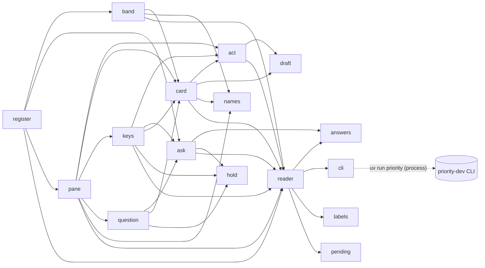

# Bounded Context Canvas — cobuilder-priority

> Documents `plugins/cobuilder-priority/` to the [Architecture Documentation Standard](../../standard.md). Grounded in code as of 2026-11-23, branch `design/priority-dev-spike`.

## 1. Name & purpose

**cobuilder-priority**. An opt-in mod that reads each main-loop stop of a session that the person switched on, with the priority-dev interpreter. It shows each reading in a pane and keeps the person's marks. It carries out no step of a reading.

## 2. Strategic classification

- **Support domain.** It feeds the improvement of the priority-dev interpreter. It decides nothing for the session.
- **Model trait:** one TypeScript hooks module of 17 files, with its tests. A single engine seam (`$` and atoms) carries all the engine-bound code; see section 6.

## 3. Ubiquitous language

| Term | Meaning inside this context |
|------|-----------------------------|
| [**Live reading**](../../../../DDD-VOCABULARY.md#live-reading) | What `priority interpret` prints for one stop, stored with its brief shape. |
| [**Reader switch**](../../../../DDD-VOCABULARY.md#reader-switch) | The per-session value that `/priority-on` and `/priority-off` set. |
| [**Reading mark**](../../../../DDD-VOCABULARY.md#reading-mark) | The person's right or wrong verdict and note on one live reading. |
| [**Reader pane**](../../../../DDD-VOCABULARY.md#reader-pane) | The side pane with one card per live reading. |

## 4. Inbound and outbound

- **Inbound.** The engine: the `classic.Stop`, `prompt.submit`, `turn.complete`, and `classic.UserPromptSubmit` events, the `AskUserQuestion` tool call, three slash commands, and the `Pane` and `AbovePrompt` renders. The marketplace lists the plugin, and the umbrella install writes its settings.
- **Outbound.** One process per CLI command: `uv run priority digest`, then `uv run priority interpret`, in the priority-dev folder (`cli.ts` only). A child `sh` process waits for a held question (`hold.ts`). `$.store` holds the readings, the marks, and the pending stops. `$.prompt` sends a chosen step.

## 5. Boundary facts (checked in code)

- **No import of priority-dev.** The hooks import only `claude-code` and their own files.
- **One reading at a time.** `reader.ts` keeps a busy flag and one waiting stop as module values.
- **No import of another plugin.** A grep of `hooks/` and `types/` finds no `plugins/` path and no `priority-dev` import. Only comments, the `uv run priority` argv, and test fixtures name priority-dev.
- **No import cycle.** `register` is the only root, and every other file has an inbound edge from a file above it. The leaves are `answers`, `cli`, `pending`, `labels`, `hold`, `draft`, and `names`.
- **The label follows the digest.** When the digest command abstains, the module runs interpret with `--digest previous`.

## 6. Port seam: pure code and engine-bound code

A later design ports this plugin to another harness. Every import of `claude-code` is the seam.

| Class | Files | Engine use |
|-------|-------|------------|
| Pure (no import) | `names.ts`, `labels.ts`, `draft.ts` | none |
| Pure parts of an engine file | `hold.ts` (`holdPaths`, `waitArgv`, `typedOr`, `answeredCount`, `allAnswered`, `answerOf`); `card.tsx` (`clock`, `sendableNow`, `firstDecide`); `types/index.d.ts` | none, except the type import in `hold.ts` |
| Store-bound | `answers.ts`, `pending.ts`, `reader.ts` (queue, `save`, `briefShape`) | `$.store`, `$.session` |
| Process-bound | `cli.ts`, `hold.ts` (`holdInChild`, `drain`) | `$.process.run`, `$.process.spawn`, `$.fs` |
| Atom-bound | `act.ts`, `ask.ts`, `reader.ts`, `register.ts`, `band.tsx`, `pane.tsx` | `atom`, `read`, `update` |
| UI-bound | `card.tsx`, `keys.tsx`, `question.tsx`, `band.tsx`, `pane.tsx`, `act.ts` (`send`), `reader.ts` (`$.ui.status`, `toast`, `scroll`) | `$.ui.*`, `ui.render`, `$.prompt`, `$.clock` |

The reader's queue, busy flag, and held-call flag are module values. They do not survive a reload, so `pending.ts` keeps a record in `$.store`. The store key strings `readings:`, `marks:`, and `asked:` appear in more than one file (`reader.ts`, `act.ts`, `answers.ts`, `pane.tsx`), so a port must keep them equal.

## 7. Open items

- A hot reload clears the queue. A reading in flight still stores its result.
- The transcript lag behind `Stop` is not measured (adapter-host.md section 7, question 3).

## C3 — Component diagram

**Key invariants (encoded in `boundary.yaml`):** `register` is the only root; `answers`, `cli`, `pending`, `labels`, `hold`, `draft`, and `names` are leaves; `cli.ts` is the only door to priority-dev, and it is a process, never an import.

## Governing decisions

- [ADR-0049](../../adr/ADR-0049-cobuilder-priority-reads-each-stop-of-a-live-session.md)
- [ADR-0045](../../adr/ADR-0045-the-priority-dev-spike-measures-its-unknowns-probes-first.md)
