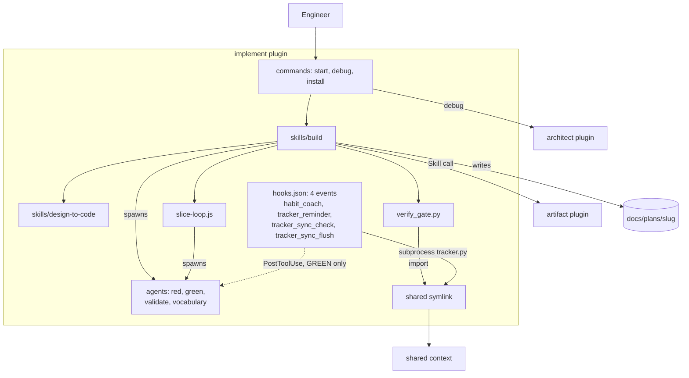
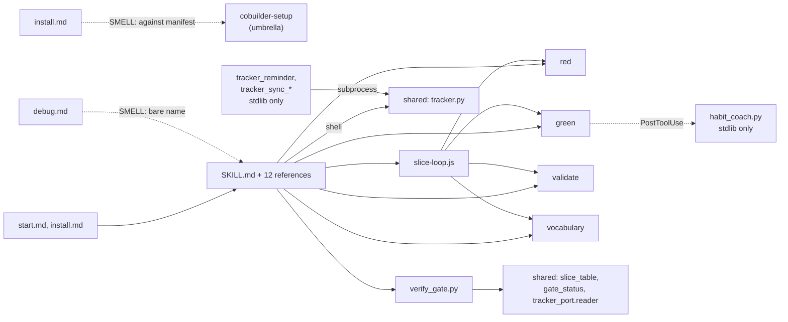

# Bounded Context Canvas — implement

> Documents `plugins/implement` to the [Architecture Documentation Standard](../../standard.md). Grounded in code as of 2026-11-10 (commit `d1e3f10`). Full treatment. Two skills, three commands, four agents, one workflow script, four hooks, and six scripts.

## 1. Name & purpose

**implement** (`implement`). It builds a design one vertical slice at a time. Four approval gates come first. Then a RED, GREEN, VALIDATE loop runs for each slice. An independent validator must score a slice 0.90 or higher against a blind rubric. It does not decide the design, and it does not show the result.

## 2. Strategic classification

- **Core domain.** It turns a decided design into tested code under human gates.
- **Model trait:** a state machine of gates plus a role-based loop. The tracker holds the state, and `shared/tracker.py` is the only way to move it (ADR-0040). `verify_gate.py` checks it.

## 3. Ubiquitous language

| Term | Meaning inside this context |
|------|-----------------------------|
| [**Epic**](../../../../DDD-VOCABULARY.md#epic) | One unit of `goal.json.epics[]`. It joins a design to a PR. |
| [**Gate 4a / 4b / 4c**](../../../../DDD-VOCABULARY.md#gate-4a-4b-4c) | The slice plan, the epic technical design, and the blind rubrics. |
| [**Gate 2b**](../../../../DDD-VOCABULARY.md#gate-2b) | The interaction-design gate that runs only for a feature with a front end. |
| [**Plugin**](../../../../DDD-VOCABULARY.md#plugin) | The installable unit. This one is the only plugin that ships agents. It ships four hooks. |
| [**Command**](../../../../DDD-VOCABULARY.md#command) | `start`, `debug`, and `install`. `install` hands over to the umbrella. |
| [**Skill**](../../../../DDD-VOCABULARY.md#skill) | `build` holds the procedure. `design-to-code` is vendored (ADR-0024). |

## 4. Business / capability decisions (what it owns)

- The four gates. Their state lives in the tracker. `00-status.md` is a file that the tracker generates.
- The slice loop, its workflow script `slice-loop.js`, the blind rubric, and the 0.90 threshold.
- The four agents: `red`, `green`, `validate`, and `vocabulary`.
- The four hooks (ADR-0025, ADR-0041, ADR-0042). `PostToolUse` coaches GREEN through habit-hooks. `SessionStart` reminds the agent to use `tracker.py`. `Stop` starts the sync worker. `SessionEnd` runs one last sync.
- The gate verifier, `verify_gate.py`.
- It does **not** own: the design record (architect), the viewer (artifact), the slice-table parser and the tracker (shared), the sync worker (shared), or the debug procedure (architect).

## 5. Inbound communication (consumers)

| Consumer | Via |
|----------|-----|
| An engineer | `/implement:start`, `/implement:debug`, `/implement:install` |
| Claude Code | Fires the four hooks on session and tool events |
| The agents | The `build` skill spawns `red`, `green`, `validate`, and `vocabulary` once per slice |
| The artifact plugin | Reads `docs/plans/<slug>` and the tracker records through `shared/build_index.py` (data only). No script or file of `implement` is imported. |

## 6. Outbound communication (dependencies + integration pattern)

| Depends on | Integration pattern |
|------------|--------------------|
| shared | Shared kernel. `verify_gate.py` imports `slice_table`, `gate_status`, and `tracker_port.reader`. The skill runs `tracker.py` and `build_index.py` by shell. The three tracker hooks start `tracker.py` as a subprocess. |
| architect | Open host service. `debug` calls the architect debug mode. **SMELL:** the call has no plugin prefix. |
| artifact | Open host service. `Skill("cobuilder-artifacts")` shows a gate and the epics route. |
| cobuilder-full-lifecycle | `install` calls `Skill("cobuilder-setup")`. **SMELL:** the umbrella depends on `implement`, so the call runs against the manifest direction. See smell 3. |
| cobuilder-memory (opt-in) | None by code. The skill uses the `consult` and `retain` tools only when the session lists them. |

## 7. Public interface (what it publishes)

The three commands, `Skill("implement:build")`, `Skill("implement:design-to-code")`, the four agents, `verify_gate.py`, and the four hooks (`SessionStart`, `PostToolUse`, `Stop`, and `SessionEnd`). It matches `boundary.yaml`.

## 8. Owned data / state

- `docs/plans/<slug>/`: gate documents, epic designs, and rubrics. The tracker generates the status file and the slice table state.
- `.cobuilder/rubrics/<slug>/`: the blind rubrics and their local evidence.
- Slice code and test changes in the engineer's repo.
- It reads the sync files in `.cobuilder/` (`sync-dirty`, `sync-lock`, `sync-status.json`, `sync-worker.log`) and `.cobuilder/tracker.yaml`. The tracker adapter and the worker write them.
- No bundle data and no viewer state.

---

## C2 — Container diagram

## C3 — Component diagram

**Key invariant(s) (encoded in `boundary.yaml`):** Only this plugin ships agents (ADR-0025). Only this plugin and the `cobuilder-memory` mod ship hooks. `habit_coach.py` and the tracker hooks are stdlib only. The tracker hooks never call `bd`, and they reach the tracker only through `shared/tracker.py`. `verify_gate.py` imports only `slice_table`, `gate_status`, and `tracker_port.reader` from shared. The plugin names no path of another plugin in code.

## Recorded smells (→ ADR candidates)

1. **A comment names an artifact path.** `scripts/verify_gate.py` lines 101-102 name `plugins/artifact/scripts/build_builds_view.py`. It is a comment, so nothing breaks. Name the shared parser only.
2. **A bare cross-plugin Skill name.** `commands/debug.md` line 26 calls `Skill("architecture")`. Use `architect:architecture`.
3. **An install handoff against the manifest direction.** `commands/install.md` line 16 calls `Skill("cobuilder-setup")` with no plugin prefix. The skill sits in `cobuilder-full-lifecycle`, and that plugin lists `implement` as a dependency. The call has a fallback message, so nothing breaks. Either sanction the handoff in an ADR and add the prefix, or move the command to the umbrella.

## Governing decisions

ADR-0012 (implement), ADR-0013 (design-mode and implement join), ADR-0024 (vendored design-to-code), ADR-0025 (slice agents and a coaching hook), ADR-0030 (check a change against the program), ADR-0040 (tracker port), ADR-0041 (SessionStart reminder hook), and ADR-0042 (Stop and SessionEnd sync hooks). ADR-0024, ADR-0025, ADR-0030, and ADR-0041 anchor to `cobuilder-packaging`. Only ADR-0048 (structure signals) anchors to `implement`, so `governed_by` lists it. The code of ADR-0048 is not built yet: `shared/structure_signals.py` does not exist.

## Other observation

`scripts/verify_gate.py` has 569 lines. The habit-smell limit for a new file is about 200 lines. This is a size note, not a boundary rule.
