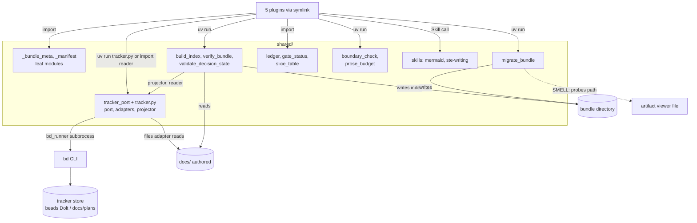
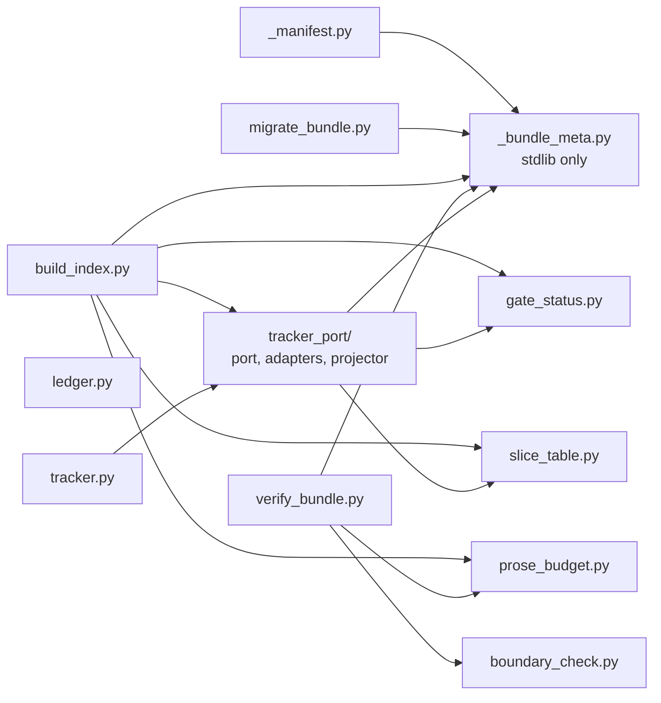

# Bounded Context Canvas — shared

> Documents `shared/` to the [Architecture Documentation Standard](../../standard.md). Grounded in code as of 2026-11-02 (commit `36b8d80`). Full treatment. 56 Python files (about 9,000 lines, 41 of them in `tracker_port/`), four reference documents, and two shared skills. Six symlinks (`plugins/<name>/shared`) point here.

## 1. Name & purpose

**shared** (`shared`). It holds the code that more than one plugin needs: bundle version constants, the record index builder, the bundle verifier, the migration ladder, the comments ledger, the gate and slice parsers, the boundary check, the prose budget, and the tracker port with its command (`tracker.py`). Two skills, `mermaid` and `ste-writing`, live here too. It is the base layer. It does not depend on a plugin.

## 2. Strategic classification

- **Supporting domain.** Plugins meet at the bundle, and this context defines the bundle contract.
- **Model trait:** shared kernel plus tools run by shell. Small modules are imported. Large tools run by `uv run`.

## 3. Ubiquitous language

| Term | Meaning inside this context |
|------|-----------------------------|
| [**Vendoring**](../../../../DDD-VOCABULARY.md#vendoring) | The symlink of `shared/` into each plugin root (ADR-0017). |
| [**Bundle**](../../../../DDD-VOCABULARY.md#bundle) | The directory whose version, layout, and index this context owns. |
| [**Script**](../../../../DDD-VOCABULARY.md#script) | A PEP 723 file. Here it can also be a module that plugins import. |
| [**Plugin**](../../../../DDD-VOCABULARY.md#plugin) | A consumer. Six plugins hold the symlink. The `cobuilder-memory` mod does not use it (TypeScript, no shared import). |
| [**Prose budget**](../../../../DDD-VOCABULARY.md#prose-budget) | The word caps in `prose_budget.py`. `verify_bundle.py` fails a bundle past twice the cap. |
| [**Tracker port**](../../../../DDD-VOCABULARY.md#tracker-port) | The interface in `tracker_port/` for every read and write of workflow state (ADR-0040). |
| [**Tracker adapter**](../../../../DDD-VOCABULARY.md#tracker-adapter) | One implementation of the port: `beads`, `files`, or `fake`. Only the beads adapter runs `bd`. |
| [**Tracker record**](../../../../DDD-VOCABULARY.md#tracker-record) | The neutral record that an adapter returns. |
| [**Projector**](../../../../DDD-VOCABULARY.md#projector) | The one function that turns record lists into `data/index.json` entities. |
| [**Tracker CLI**](../../../../DDD-VOCABULARY.md#tracker-cli) | `tracker.py`, the one command that agents call. |
| [**Stale boundary**](../../../../DDD-VOCABULARY.md#stale-boundary) | A context that `boundary_check.py` lists. |

## 4. Business / capability decisions (what it owns)

- The bundle version constants, the design stages, and the compatibility gate (`_bundle_meta.py`).
- The record index: `build_index.py` is the only writer of `data/adrs.json` and `data/index.json`.
- The two-ladder migration: layout (`bundle_format`), then data (`schema_version`).
- The bundle verifier and the decision-state validator.
- The comments ledger, the gate-block parser, and the slice-table parser.
- The boundary check and the prose budget.
- The tracker port in `tracker_port/` (ADR-0040): the neutral record, the port, the projector, the adapters (`beads`, `files`, `fake`), the plan readers, and the one command `tracker.py`.
- The habit-sensors scan wrapper, `habit_smells.py`, which records a missing tool.
- It does **not** own: any narrative, ADR text, or viewer code. It does not author content.

## 5. Inbound communication (consumers)

| Consumer | Via |
|----------|-----|
| pr | Import `_bundle_meta` and `_manifest`. Shell: `migrate_bundle`, `build_index`, `verify_bundle`, `tracker.py` |
| artifact | Import `_bundle_meta`, `ledger`, `gate_status`, `slice_table`, and `tracker_port.reader` (`build_builds_view.py`). Shell: `build_index`, `migrate_bundle`, `tracker.py` |
| implement | Import `slice_table`, `gate_status`, and `tracker_port.reader` (`verify_gate.py`). Shell: `build_index`, `tracker.py` (seven files name it) |
| architect | Shell only: `build_index`, `migrate_bundle`, `prose_budget`, `boundary_check`, `validate_decision_state`, `habit_smells`, `tracker.py` |
| cobuilder-packaging | `watch_feedback.py` imports `ledger` |

## 6. Outbound communication (dependencies + integration pattern)

| Depends on | Integration pattern |
|------------|--------------------|
| Standard library, PyYAML, optional `ulid` | External packages, resolved by `uv` |
| The artifact viewer file | **SMELL.** `migrate_bundle.py` finds and copies `plugins/artifact/viewer/index.html`. See Recorded smells. |
| git | `build_index.py` and `boundary_check.py` run `git` through `subprocess` |
| `habit-sensors` (external tool) | `habit_smells.py` runs it through `subprocess`. A missing tool is recorded, not an error. |
| `bd` (the beads CLI) | Only the beads adapter and `bd_runner.py` run it, through `subprocess` (ADR-0040). |
| The tracker store | The adapter reads and writes it. Beads keeps a local Dolt database. The `files` adapter reads `docs/plans`. |

## 7. Public interface (what it publishes)

The symbols in `boundary.yaml` `public_interface`: the `_bundle_meta` constants and functions, `_manifest.rewrite_manifest`, the `ledger` API, `gate_status`, `slice_table`, `tracker_port` (`reader`, `projector`, `load_adapter`, `TrackerPort`), the shell tools (with `tracker.py`), and the two shared skills.

## 8. Owned data / state

- The code and the two shared skills.
- The adapter config contract for `.cobuilder/tracker.yaml`, and the sync files that the beads adapter writes into `.cobuilder/` (`sync-dirty`, `sync-lock`, `sync-status.json`, `sync-worker.log`). The repo owns the config file itself.
- The workflow state inside a tracker (programs, epics, slices, and pull request records). The tracker holds it, and the adapter reads and writes it.
- The derived files it writes into a bundle: `data/index.json`, `data/adrs.json`, `bundle.json` updates, and the refreshed `viewer/index.html` copy.
- It owns no authored source. `docs/` is read, never written. The `regenerate-status-files` and `strip_goal_stage.py` operations are exceptions: they write generated state lines into `docs/plans` status files and strip `stage` from `goal.json`, on the engineer's command.

---

## C2 — Container diagram

## C3 — Component diagram

**Key invariant(s) (encoded in `boundary.yaml`):** `_bundle_meta.py` imports only the standard library. `ledger.py`, `gate_status.py`, and `slice_table.py` are leaves. No file in `shared/` imports a plugin as Python. `tracker_port/` imports only `_bundle_meta`, `gate_status`, `slice_table`, and PyYAML, and only the beads adapter files and `bd_runner.py` run `bd`.

## Recorded smells (→ ADR candidates)

1. **Shared reaches into the artifact plugin.** `migrate_bundle.py` `find_viewer_source` (lines 338-366) probes `plugins/artifact/viewer/index.html` and the sibling `artifact/<version>/viewer/index.html` cache. A warning at line 577 names `plugins/artifact/`. A base layer should not know a plugin path. ADR candidate: pass the viewer path as an argument.
2. **Comments name plugin paths.** `_bundle_meta.py` line 32 names `plugins/artifact/viewer/src/shell/workDeck.ts`. `slice_table.py` lines 23-24 name two plugin scripts. They are comments, so nothing breaks. Replace them with plugin names.
3. **Run-from-cache hazard.** CLAUDE.md warns that the installed cache copy refreshes the viewer with an older build. It is the same coupling as smell 1.
4. **Observation, not a violation: size.** `build_index.py` has 1,766 lines and `migrate_bundle.py` has 655. The habit-smell limits in CLAUDE.md apply to new code, so no rule fails. A change that adds to these files should extract a module first.
5. **Observation: the adapter list is closed in code.** `tracker_port/config.py` `load_adapter` names each adapter in an `if` chain (`fake`, `files`, `beads`). A new adapter needs an edit in `config.py`, and a stub for each optional port it cannot serve (`migrate_mapping`, `repair_status`), as the `files` and `fake` adapters keep. This is by design in ADR-0040. It matters for the next adapter, so no ADR is needed to record it.

## Governing decisions

ADR-0040 (the tracker port, anchored here by its `maps_to`), ADR-0017 (vendored shared code and bundle compatibility), ADR-0006 (three-phase bundle self-migration), and ADR-0022 (gate doc projection into the index). ADR-0017 and ADR-0022 anchor to `cobuilder-packaging`, so `governed_by` here lists only ADR-0040. ADR-0017's `require_compatible` gate now exists in `_bundle_meta.py`, and the packaging record from 2026-08-21 was wrong to call it absent.
