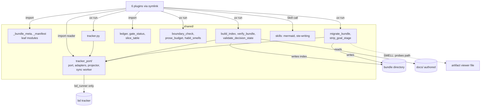
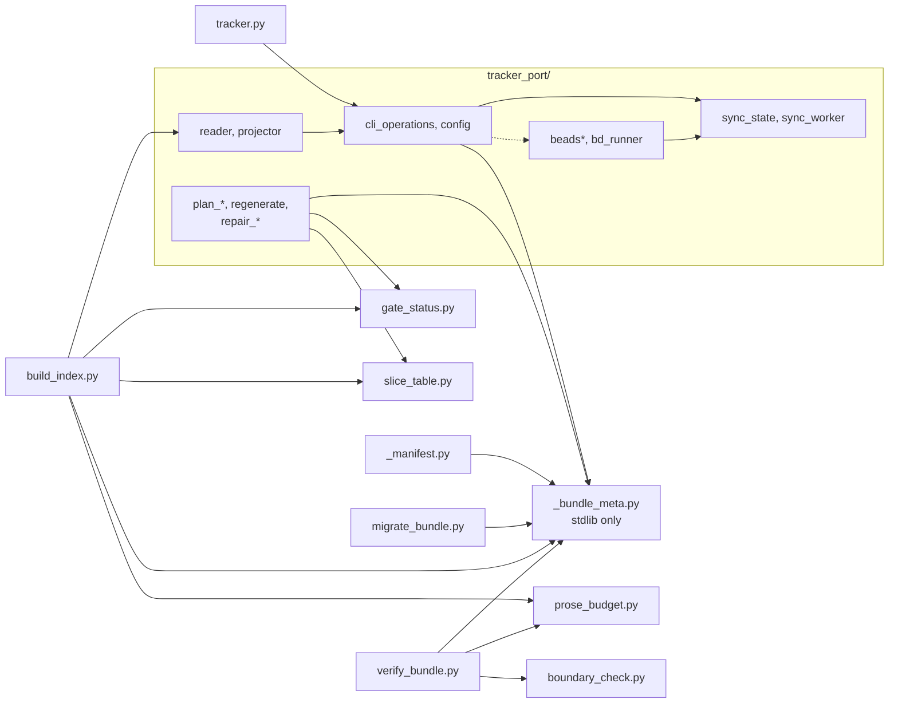

# Bounded Context Canvas — shared

> Documents `shared/` to the [Architecture Documentation Standard](../../standard.md). Grounded in code as of 2026-11-10 (commit `d1e3f10`). Full treatment. 15 top-level Python files, 40 Python files in `tracker_port/`, four reference documents, and two shared skills. Six symlinks (`plugins/<name>/shared`) point here.

## 1. Name & purpose

**shared** (`shared`). It holds the code that more than one plugin needs: bundle version constants, the record index builder, the bundle verifier, the migration ladder, the comments ledger, the gate and slice parsers, the boundary check, the prose budget, and the tracker. The tracker is the tracker port, its three adapters (beads, files, fake), the projector, the sync worker, and the `tracker.py` command. Two skills, `mermaid` and `ste-writing`, live here too. It is the base layer. It does not depend on a plugin.

## 2. Strategic classification

- **Supporting domain.** Plugins meet at the bundle, and this context defines the bundle contract. It also holds the workflow state port (ADR-0040).
- **Model trait:** shared kernel plus tools run by shell. Small modules are imported. Large tools run by `uv run`.

## 3. Ubiquitous language

| Term | Meaning inside this context |
|------|-----------------------------|
| [**Vendoring**](../../../../DDD-VOCABULARY.md#vendoring) | The symlink of `shared/` into each plugin root (ADR-0017). |
| [**Bundle**](../../../../DDD-VOCABULARY.md#bundle) | The directory whose version, layout, and index this context owns. |
| [**Script**](../../../../DDD-VOCABULARY.md#script) | A PEP 723 file. Here it can also be a module that plugins import. |
| [**Plugin**](../../../../DDD-VOCABULARY.md#plugin) | A consumer. Six plugins hold the symlink, and five of them use it. |
| [**Prose budget**](../../../../DDD-VOCABULARY.md#prose-budget) | The word caps in `prose_budget.py`. `verify_bundle.py` fails a bundle past twice the cap. |
| [**Stale boundary**](../../../../DDD-VOCABULARY.md#stale-boundary) | A context that `boundary_check.py` lists. |
| [**Tracker port**](../../../../DDD-VOCABULARY.md#tracker-port) | The interface in `tracker_port/port.py`. The glossary assigns it to `cobuilder-packaging`, but the code lives here. |
| [**Tracker adapter**](../../../../DDD-VOCABULARY.md#tracker-adapter) | One implementation of the port: `beads`, `files`, or `fake`. |
| [**Projector**](../../../../DDD-VOCABULARY.md#projector) | `tracker_port/projector.py`. It turns tracker records into the entities of `data/index.json`. |
| [**Tracker CLI**](../../../../DDD-VOCABULARY.md#tracker-cli) | `tracker.py`, the one command for workflow state. |

## 4. Business / capability decisions (what it owns)

- The bundle version constants, the design stages, and the compatibility gate (`_bundle_meta.py`).
- The record index: `build_index.py` is the only writer of `data/adrs.json` and `data/index.json`.
- The two-ladder migration: layout (`bundle_format`), then data (`schema_version`). Also `strip_goal_stage.py`, which removes a stage that the tracker already holds.
- The bundle verifier and the decision-state validator.
- The comments ledger, the gate-block parser, and the slice-table parser.
- The boundary check, the prose budget, and the habit-smells scan (`habit_smells.py`).
- The tracker port, its adapters, the projector, the sync state and worker, and the `tracker.py` operations. The `bd` command runs only in `bd_runner.py`.
- It does **not** own: any narrative, ADR text, or viewer code. It does not author content.

## 5. Inbound communication (consumers)

| Consumer | Via |
|----------|-----|
| pr | Import `_bundle_meta` and `_manifest`. Shell: `migrate_bundle`, `build_index`, `verify_bundle`, `tracker` |
| artifact | Import `_bundle_meta`, `ledger`, `gate_status`, `slice_table`, and `tracker_port.reader`. Shell: `build_index`, `migrate_bundle`, `tracker` |
| implement | Import `slice_table`, `gate_status`, and `tracker_port.reader` in `verify_gate.py`. Shell: `build_index`, `tracker`. The tracker hook scripts run `tracker.py` by subprocess |
| architect | Shell only: `build_index`, `migrate_bundle`, `prose_budget`, `boundary_check`, `validate_decision_state`, `habit_smells`, `tracker` |
| cobuilder-packaging | `watch_feedback.py` imports `ledger`. The install command and setup skill run `tracker.py` |
| cobuilder-memory | Holds the symlink. It imports and runs nothing from `shared/`. |

## 6. Outbound communication (dependencies + integration pattern)

| Depends on | Integration pattern |
|------------|--------------------|
| Standard library, PyYAML, optional `ulid`, lazy `PIL` | External packages, resolved by `uv` |
| The artifact viewer file | **SMELL.** `migrate_bundle.py` finds and copies `plugins/artifact/viewer/index.html`. See Recorded smells. |
| git | `build_index.py`, `boundary_check.py`, `validate_decision_state.py`, and `habit_smells.py` run `git` through `subprocess` |
| The `bd` binary | Only `bd_runner.py` runs it. `beads*.py` build the arguments. |
| The `habit-sensors` tool | `habit_smells.py` runs it by subprocess when it is on the PATH. |
| `uv` | `sync_state.spawn_worker` starts `uv run tracker.py sync-worker` detached. |

## 7. Public interface (what it publishes)

The symbols in `boundary.yaml` `public_interface`: the `_bundle_meta` constants and functions, `_manifest.rewrite_manifest`, the `ledger` API, `gate_status`, `slice_table`, `tracker_port.reader`, the shell tools, and the two shared skills. The reference documents `tracker-usage.md`, `tracker-backfill.md`, `tracker-adapter-beads.md`, and `prose-budget.md` describe the tracker and the prose caps.

## 8. Owned data / state

- The code, the reference documents, the formula `tracker_port/formulas/slice-loop.toml`, and the two shared skills.
- The derived files it writes into a bundle: `data/index.json`, `data/adrs.json`, `bundle.json` updates, and the refreshed `viewer/index.html` copy.
- The sync files in `.cobuilder/` of the host repo: `sync-dirty`, `sync-lock`, `sync-status.json`, and `sync-worker.log`.
- It owns no authored source. `docs/` is read, never written.

---

## C2 — Container diagram

## C3 — Component diagram

**Key invariant(s) (encoded in `boundary.yaml`):** `_bundle_meta.py` imports only the standard library. `ledger.py`, `gate_status.py`, and `slice_table.py` are leaves. No file in `shared/` imports a plugin as Python. Only `bd_runner.py` runs the `bd` command. Only `BeadsAdapter.sync` runs `bd sync`.

## Recorded smells (→ ADR candidates)

1. **Shared reaches into the artifact plugin.** `migrate_bundle.py` `find_viewer_source` (lines 338-369) probes `plugins/artifact/viewer/index.html` and the sibling `artifact/<version>/viewer/index.html` cache. A warning at line 577 names `plugins/artifact/`. A base layer should not know a plugin path. ADR candidate: pass the viewer path as an argument.
2. **Comments name plugin paths.** `_bundle_meta.py` line 32 names `plugins/artifact/viewer/src/shell/workDeck.ts`. `slice_table.py` lines 23-24 name two plugin scripts. They are comments, so nothing breaks. Replace them with plugin names.
3. **Run-from-cache hazard.** CLAUDE.md warns that the installed cache copy refreshes the viewer with an older build. It is the same coupling as smell 1.
4. **The `bd` rule is wider than the code.** CLAUDE.md says only `beads*.py` and `bd_runner.py` name `bd`. In code, `config.py` reads the `bd` key of `tracker.yaml` and builds `BdRunner` and `BeadsAdapter`. Two comments in `fake_support.py` and `record.py` also say `bd`. No command runs there. `tests/test_tracker_docs.py` skips `shared/tracker_port/`, so no test holds the narrow rule. ADR candidate: name `config.py` in the rule, or move the beads branch into a beads module.
5. **The sync rule is wider than the code.** CLAUDE.md says only the beads adapter and `sync_worker.py` run a sync. In code, `sync_once` in `sync_state.py` calls `adapter.sync()`, and `cli_operations.py` calls `sync_once` for the `sync` operation. The spawner also sits in `sync_state.py`. The `bd sync` command itself runs only in `BeadsAdapter.sync`, and the hook scripts never call `bd`. ADR candidate: widen the rule to name `sync_state.py` and the CLI `sync` operation.
6. **The glossary puts the tracker terms in the wrong context.** `DDD-VOCABULARY.md` assigns Tracker port, Tracker adapter, Projector, and Tracker CLI to `cobuilder-packaging`. The code is in `shared/`. Move the terms or document the split.

## Governing decisions

ADR-0017 (vendored shared code and bundle compatibility), ADR-0006 (three-phase bundle self-migration), and ADR-0022 (gate doc projection into the index). The tracker code follows ADR-0040 (tracker port), ADR-0031 (beads storage), ADR-0041 (tracker reminder hook), and ADR-0042 (sync). ADR-0047 covers the program stage from the tracker. These ADRs anchor to `cobuilder-packaging`, so `governed_by` here stays empty.
